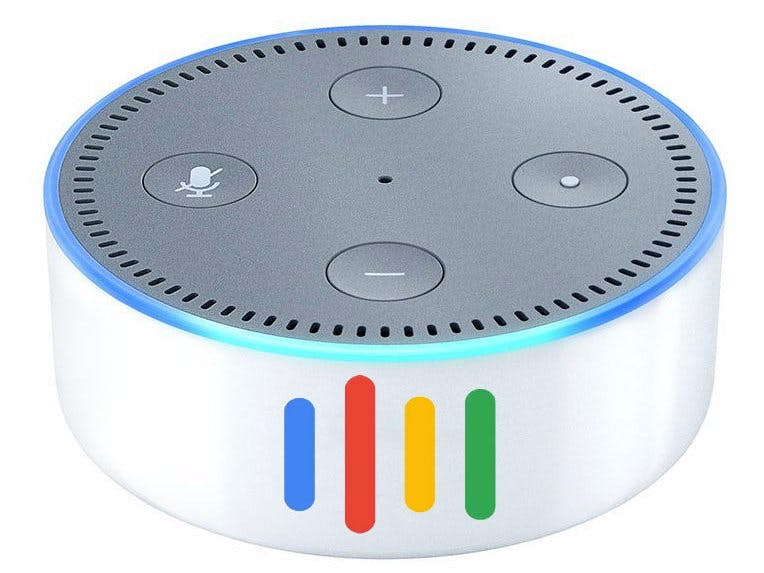
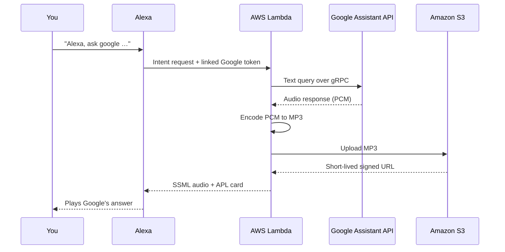

<div align="center">



# Alexa Assistant

**Use Google Assistant through your Amazon Alexa device.**

An unofficial Alexa skill that forwards your questions to the Google Assistant API and plays back Google's spoken answer.

[](https://github.com/rokmohar/alexa-assistant/releases/latest)
[](LICENSE)
[](.nvmrc)
[](https://www.serverless.com/framework/docs)

</div>

> [!IMPORTANT]
> Something not working? Check [Troubleshooting](docs/common_problems.md) before opening an issue.

## Table of contents

- [Features](#features)
- [How it works](#how-it-works)
- [Prerequisites](#prerequisites)
- [Installation](#installation)
- [Configuration](#configuration)
- [Usage](#usage)
- [Development](#development)
- [Troubleshooting](#troubleshooting)
- [Uninstalling](#uninstalling)
- [Contributing](#contributing)
- [License](#license)

## Features

- **Ask Google anything** from any Alexa device: "Alexa, ask google what's the weather like".
- **Spoken answers in Google's voice**, plus a visual card on Echo Show and other screen devices (APL).
- **Follow-up questions** keep the session open when Google expects a reply.
- **Location-aware answers**. The skill looks for a location in this order:
  1. a location you saved by voice,
  2. the Alexa device's GPS (mobile devices),
  3. the Alexa device's address,
  4. the address in your Google profile.
- **Language preference** saved per user, for example German, Japanese, or British English.
- **Self-hosted** on your own AWS account. Deployment uses one Serverless Framework command.

## How it works



User settings (saved location and language) are stored in a DynamoDB table.

## Prerequisites

- [Node.js](https://nodejs.org/) 24.x and npm 11+
- An [AWS account](https://aws.amazon.com/) with the [AWS CLI](https://aws.amazon.com/cli/) configured
- A [Google Cloud](https://console.cloud.google.com/) project with the Google Assistant API enabled
- An [Amazon Developer](https://developer.amazon.com/alexa) account

## Installation

The full step-by-step guide is in **[docs/serverless_install.md](docs/serverless_install.md)**. It covers the Alexa interaction model, the Google OAuth setup, and account linking. Short version:

```bash
git clone https://github.com/rokmohar/alexa-assistant.git
cd alexa-assistant
npm install
cp .env.example .env   # then fill in your values (see Configuration)
npm run deploy:prod
```

Serverless creates the Lambda function, the S3 bucket for audio, and the `AlexaAssistantSkillSettings` DynamoDB table.

### Other ways to install

<details>
<summary><strong>Prebuilt release ZIP</strong></summary>

Every [release](https://github.com/rokmohar/alexa-assistant/releases) includes `alexa-assistant-vX.Y.Z.zip`. You can upload it to a Lambda function in the AWS Console:

- **Runtime:** Node.js 24.x
- **Handler:** `index.handler`
- **Environment variables:** see [Configuration](#configuration)

With this option you must create the S3 bucket, the DynamoDB table (`AlexaAssistantSkillSettings`, partition key `userId`), and the IAM permissions yourself. [`serverless.yml`](serverless.yml) shows what is needed.

</details>

<details>
<summary><strong>Build the ZIP with Docker</strong></summary>

```bash
docker build -t alexa-assistant .
docker run --rm --entrypoint cat alexa-assistant ./lambda.zip > lambda.zip
```

</details>

## Configuration

Set these in `.env`. Serverless passes them to the Lambda function.

| Variable              | Required | Default                            | Description                                  |
| --------------------- | :------: | ---------------------------------- | -------------------------------------------- |
| `ALEXA_SKILL_ID`      |   Yes    | —                                  | Skill ID from the Alexa Developer Console    |
| `GOOGLE_PROJECT_ID`   |   Yes    | —                                  | Google Cloud project ID                      |
| `S3_BUCKET`           |   Yes    | —                                  | Bucket name for audio (must be globally unique) |
| `GOOGLE_API_ENDPOINT` |    No    | `embeddedassistant.googleapis.com` | Google Assistant gRPC endpoint               |

## Usage

Enable the skill in the Alexa app and link your Google account. Then try:

| Say                                              | Result                                        |
| ------------------------------------------------ | --------------------------------------------- |
| "Alexa, ask google who is the queen of england"  | Asks Google Assistant                         |
| "Alexa, ask google to set my location to Paris"  | Saves a location for location-aware answers   |
| "Alexa, ask google what location is saved"       | Reads back the saved location                 |
| "Alexa, ask google to clear my location"         | Removes the saved location                    |
| "Alexa, ask google to set my language to German" | Sets the language for Google's answers        |
| "Alexa, ask google what language is set"         | Reads back the language                       |
| "Alexa, ask google to reset my language"         | Uses the Alexa device's language again        |

Supported languages: English (US, UK, Australia, Canada, India), German, French (France, Canada), Spanish, Italian, Japanese, Korean, and Portuguese.

## Development

```bash
npm install          # also installs the Husky pre-commit hook (ESLint + Prettier)
npm run build        # bundle to dist/ with webpack + Babel
npm start            # run locally with serverless-offline
```

| Script              | Description                                  |
| ------------------- | -------------------------------------------- |
| `npm run typecheck` | Type-check with `tsc`                        |
| `npm run lint`      | Lint with ESLint (`lint:fix` to auto-fix)    |
| `npm run format`    | Check formatting (`format:fix` to apply)     |
| `npm run deploy`    | Deploy the default stage                     |
| `npm run logs`      | Tail the Lambda function's CloudWatch logs   |

Project layout:

```
src/
├── index.ts        # Alexa request handlers (intents)
├── config/         # Environment config, validated with zod
├── services/       # Assistant (gRPC), Encoder (MP3), Bucket (S3), Location, …
├── factories/      # Service wiring
├── interfaces/     # Shared types
└── errors/         # Error types and handler
```

## Troubleshooting

- **[Troubleshooting guide](docs/common_problems.md)**: account linking loops, the skill's error messages, wrong location or language, and more.
- Check the logs with `npm run logs`.
- Still stuck? [Open a bug report](https://github.com/rokmohar/alexa-assistant/issues/new/choose).

## Uninstalling

1. The audio bucket has versioning turned on, so CloudFormation can't delete it until it's empty. Open the bucket in the [S3 console](https://console.aws.amazon.com/s3/) and click **Empty**. This also deletes old versions.
2. Remove the stack:

   ```bash
   npx serverless remove
   ```

This removes the Lambda function, the S3 bucket, and the DynamoDB table. Your saved locations and languages are deleted too.

## Contributing

Contributions are welcome. See [CONTRIBUTING.md](CONTRIBUTING.md) for development setup and the pull request process. This project follows the [Code of Conduct](CODE_OF_CONDUCT.md).

Found a security issue? Please follow the [Security policy](SECURITY.md) instead of opening a public issue.

## License

[GPL-3.0](LICENSE) © Rok Mohar

---

<sub>This project is not affiliated with, endorsed by, or sponsored by Google LLC or Amazon.com, Inc. Google Assistant is a trademark of Google LLC. Alexa and Echo are trademarks of Amazon.com, Inc.</sub>
